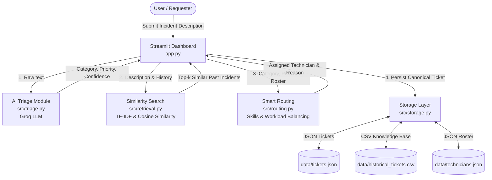

# AI-Powered IT Helpdesk Ticket Triage

[](https://www.python.org/)
[](https://streamlit.io/)
[](https://groq.com/)
[]()

A fast, lightweight, and explainable campus IT helpdesk triage MVP built for the TCS AI Hackathon.
This application accepts incoming helpdesk tickets, classifies them with LLM reasoning, searches past resolved incidents using TF-IDF similarity, balances workloads to assign qualified technicians, and provides an operator dashboard in Streamlit.

> [!WARNING]
> **Synthetic Demonstration Data**: All records in `data/historical_tickets.csv` and `data/technicians.json` are synthetic demonstration data created exclusively for testing and hackathon demonstration. They do not represent real individuals, institutional credentials, or live systems.

---

## 1. Architecture Overview



---

## 2. Project Directory Structure

```text
helpdesk-triage/
├── app.py                      # Streamlit UI dashboard (Member 5)
├── requirements.txt            # Minimal MVP Python dependencies
├── .env.example                # Template for Groq API key and model config
├── .gitignore                  # Git ignore rules (protects .env and caches)
├── README.md                   # Complete system and contract documentation
├── data/
│   ├── historical_tickets.csv  # 14 synthetic past incidents with resolutions (Member 3)
│   ├── technicians.json        # 4 fictional technician profiles with skills (Member 4)
│   └── tickets.json            # Active ticket storage (initialized to [])
├── src/
│   ├── __init__.py             # Package marker
│   ├── schemas.py              # Frozen shared contracts, enums, defaults (Member 1)
│   ├── triage.py               # Groq LLM ticket classification stub (Member 2)
│   ├── retrieval.py            # TF-IDF similarity search stub (Member 3)
│   ├── routing.py              # Technician assignment stub (Member 4)
│   └── storage.py              # File-based CSV & JSON storage layer (Member 1)
└── tests/
    └── test_contracts.py       # Contract, schema, and storage tests (Member 1)
```

---

## 3. Team Ownership and Boundaries

To deliver a working MVP within our 4-hour window, **responsibilities are strictly partitioned**. Team members develop their assigned modules in parallel.

| Team Member | Role | Assigned Files | Responsibilities & Boundaries |
| :--- | :--- | :--- | :--- |
| **Member 1 (Lead)** | Architecture & Integration | `src/schemas.py`<br>`src/storage.py`<br>`tests/test_contracts.py` | Shared contract freezing, file-based persistence, end-to-end integration, automated testing, final demo. |
| **Member 2** | Groq Classification | `src/triage.py` | Integrates Groq API with structured JSON output, classification reasoning, confidence scoring, and human-review flags. **Must preserve function signature.** |
| **Member 3** | Historical Retrieval | `src/retrieval.py`<br>`data/historical_tickets.csv` | Implements TF-IDF vectorization and cosine similarity over historical tickets. Returns real past resolutions without hallucinations. |
| **Member 4** | Technician Routing | `src/routing.py`<br>`data/technicians.json` | Skills-based technician matching with workload balancing and human-readable assignment rationale. Graceful unassigned fallback. |
| **Member 5** | UI & Presentation | `app.py` | Modern Streamlit dashboard. Consumes module interfaces without duplicating business logic inside the UI. |

---

## 4. Environment Setup & Dependency Installation

### Step 1: Clone / Navigate to project
```bash
cd helpdesk-triage
```

### Step 2: (Recommended) Create a virtual environment
```bash
# Windows
python -m venv .venv
.venv\Scripts\activate

# macOS / Linux
python3 -m venv .venv
source .venv/bin/activate
```

### Step 3: Install MVP dependencies
```bash
pip install -r requirements.txt
```

### Step 4: Configure Environment Variables
Copy the example environment file:
```bash
# Windows (PowerShell)
Copy-Item .env.example .env

# macOS / Linux
cp .env.example .env
```
Edit `.env` and add your Groq API key:
```env
GROQ_API_KEY=gsk_your_actual_groq_api_key_here
GROQ_MODEL=llama-3.3-70b-versatile
```
> [!NOTE]
> The skeleton runs and passes all tests **without** an active Groq API key. An API key is only needed when testing live LLM classification in Member 2's module.

---

## 5. Running the Application and Tests

### Run Automated Tests
```bash
# Run all tests (contracts and AI triage)
pytest tests/ -v

# Run AI Triage unit tests specifically
pytest tests/test_triage.py -v
```
All contract and triage tests validate:
- Canonical Enums (`Category`, `Priority`, `ImpactScope`)
- 21 canonical ticket fields
- Safe fallback shapes from stubs and live modules
- Storage persistence, ticket creation, and update mechanics
- Safe handling of empty or missing data files
- Groq AI triage JSON parsing, schema sanitization, prompt injection defense, and graceful API failure handling

### Launch Streamlit Dashboard
```bash
streamlit run app.py
```
Open `http://localhost:8501` in your browser.

---

## 6. Shared Canonical Contracts (FROZEN)

All team members must use the canonical constants and values defined in `src/schemas.py`. Do not create competing spellings or casing.

### Categories
- `Hardware`
- `Network`
- `Software`
- `Database`
- `Account & Access`
- `Email & Collaboration`
- `Other`

### Priorities
- `Critical`
- `High`
- `Medium`
- `Low`

### Impact Scopes
- `single_user`
- `multiple_users`
- `building`
- `campus`
- `unknown`

### Canonical Ticket Schema (21 Fields)
```python
{
    "ticket_id": str,               # Unique ID, e.g. "TICK-0001"
    "created_at": str,              # ISO 8601 UTC timestamp
    "raised_by": str,               # "student" | "faculty" | "staff" | "other"
    "building": str,                # Location or facility name
    "description": str,             # Requester's raw issue text
    "category": str,                # One of canonical Categories
    "subcategory": str,             # Granular subcategory
    "priority": str,                # One of canonical Priorities
    "impact_scope": str,            # One of canonical Impact Scopes
    "triage_reason": str,           # LLM explanation for triage
    "triage_confidence": float,     # Confidence score between 0.0 and 1.0
    "needs_human_review": bool,     # True if confidence is low or priority critical
    "similar_tickets": list,        # List of matched historical tickets
    "suggested_resolution": str,    # Synthesized resolution steps
    "assigned_technician_id": str,  # e.g. "TECH-001" or ""
    "assigned_technician_name": str,# e.g. "Alex Morgan" or "Unassigned"
    "assigned_team": str,           # Operating team or unit
    "assignment_reason": str,       # Rationale for routing decision
    "status": str,                  # "open" | "in_progress" | "resolved" | "closed"
    "resolution": str,              # Final documented resolution
    "time_to_resolve_hrs": float    # Hours to resolution
}
```

---

## 7. Public Function Signatures

### Member 2: `src/triage.py`
```python
def triage_ticket(
    description: str,
    raised_by: str = "student",
    building: str = "Unknown",
    context: dict | None = None
) -> dict:
    """Classifies description into canonical category, subcategory, priority, and impact scope."""
    ...
```
**Expected return keys:**
`category`, `subcategory`, `priority`, `impact_scope`, `triage_reason`, `triage_confidence`, `needs_human_review`

### Member 3: `src/retrieval.py`
```python
def find_similar_tickets(
    description: str,
    historical_tickets: list[dict],
    top_k: int = 3
) -> list[dict]:
    """Finds top-k similar historical incidents using TF-IDF / cosine similarity."""
    ...
```
**Expected return list item fields:**
`ticket_id`, `description`, `category`, `priority`, `resolution`, `similarity`

### Member 4: `src/routing.py`
```python
def assign_technician(
    category: str,
    priority: str,
    technicians: list[dict],
    active_tickets: list[dict] | None = None
) -> dict:
    """Matches ticket to qualified technician balancing active workload."""
    ...
```
**Expected return keys:**
`assigned_technician_id`, `assigned_technician_name`, `assigned_team`, `assignment_reason`

### Member 1: `src/storage.py`
```python
def load_historical_tickets() -> list[dict]: ...
def load_technicians() -> list[dict]: ...
def load_tickets() -> list[dict]: ...
def save_tickets(tickets: list[dict]) -> None: ...
def create_ticket(ticket: dict) -> dict: ...
def update_ticket(ticket_id: str, updates: dict) -> dict | None: ...
```

---

## 8. Alignment Rules Before Parallel Coding

1. **Do not modify function signatures**: If you feel a signature needs an extra parameter, communicate in the team sync first.
2. **Never commit `.env`**: Always use `.env.example` as the template.
3. **No database servers or Docker**: We use clean JSON and CSV files in `data/` to guarantee zero-friction handoffs.
4. **All paths relative to project root**: `src/storage.py` resolves paths relative to `Path(__file__).parent.parent`. Never rely on `os.getcwd()`.
5. **Keep tests green**: Run `pytest tests/test_contracts.py` before pushing any branch.
